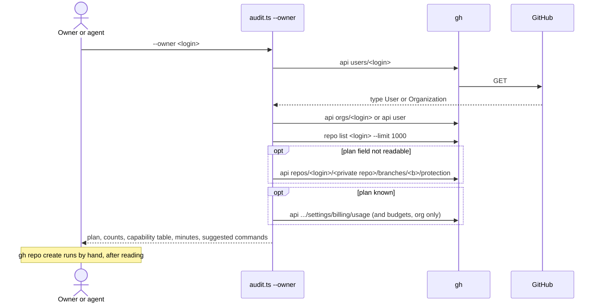
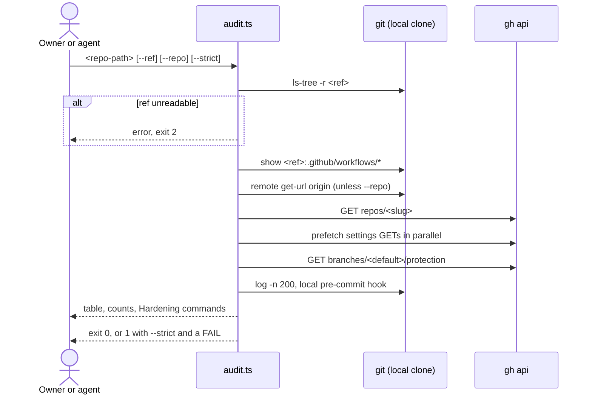
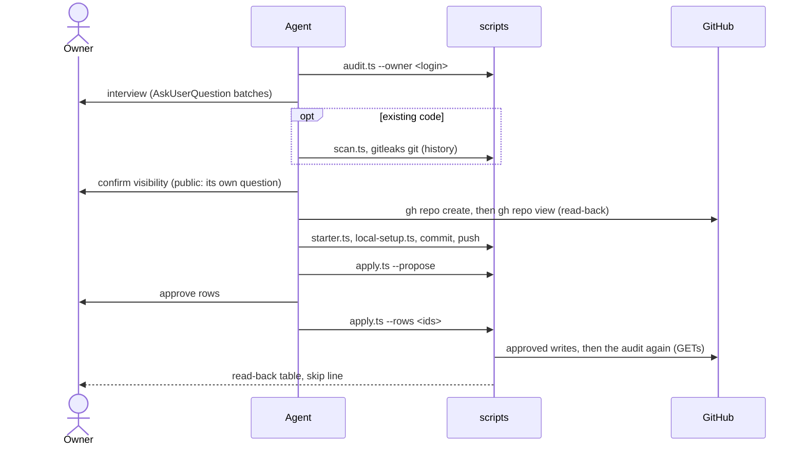
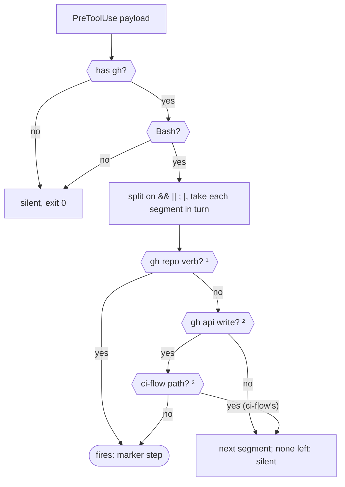
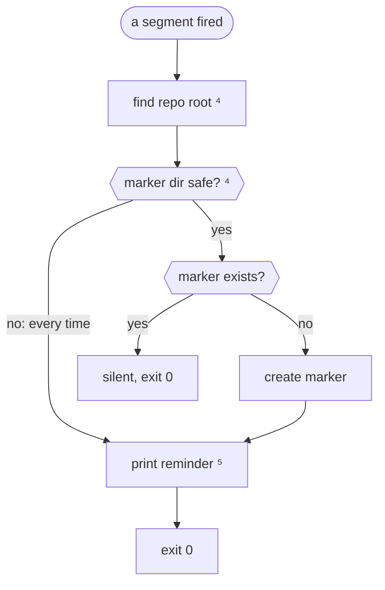

# App Flow: repo-create

> [!NOTE]
> repo-create has no screens: its journeys are commands an owner or an agent runs, and one hook. Procedure and rules: [`SKILL.md`](../skills/repo-create/SKILL.md) and [`POLICY.md`](../skills/repo-create/POLICY.md). Planned modes: design spec §3 ([`docs/superpowers/specs/2026-11-09-repo-create-design.md`](superpowers/specs/2026-11-09-repo-create-design.md)).

## Journeys

| Journey | Entry | Status |
|---|---|---|
| Before creating a repo | `bun audit.ts --owner <login>`, then `gh repo create` by hand | DONE |
| Audit an existing repo | `bun audit.ts <repo-path>`; apply printed fixes by hand; run again | DONE |
| Hook reminder | an agent's Bash command that changes repository settings | DONE |
| New repo: interview, scan, create, starter files, proposal, apply | `/repo-create` (`SKILL.md` "New repo journey") | scripts DONE; prose IN PROGRESS; rehearsal OPEN |
| Existing repo: proposal, apply | `/repo-create --audit <path>` (`SKILL.md` "Existing repo journey") | scripts DONE; prose IN PROGRESS; rehearsal OPEN |
| `--audit --all`, `--launch`, `--transfer`, `--archive`, `--secrets`, `--cleanup` | design spec §3 (plan 3) | OPEN |

## Before creating a repo (`--owner`)

1. The owner or agent runs `bun ~/.claude/skills/repo-create/scripts/audit.ts --owner <login>`.
2. The report names the owner type, the plan (read, or inferred from a private repo's protection), the repo counts, what a new private and a new public repo get, this month's Actions minutes, and a random development name.
3. Nothing is created. The report suggests `gh repo create <login>/<random-name> --private`, the audit to run after the first push, and the rename at launch. On a plan whose private repos get no protection, it suggests creating the repo under the Team org instead.

## Audit an existing repo

1. `bun audit.ts <repo-path> [--ref <git-ref>] [--repo <owner/name>] [--strict]`.
2. The tree is read at the ref (default `origin/main`) with `git show`, never the working tree.
3. The slug comes from `--repo` or the `origin` URL; repository, protection and settings are read with `gh api` GETs.
4. The 24 checks run; each row is `pass`, **FAIL**, **blocked** or `n.a.` with its evidence.
5. Fixes print under "Hardening — suggested, NOT applied". The owner reads and runs them by hand, then audits again.

## New repo (`/repo-create`)

The agent follows `SKILL.md` "New repo journey"; every question is an `AskUserQuestion`, and nothing is written to GitHub before the owner answers.

1. `audit.ts --owner <login>` (and `<org>`): plan, counts, minutes, a random development name. A plan it cannot read is asked.
2. Interview: owner and plan; then visibility, existing code, purpose signals; then name and licence (`none`, or `full` with `mit` or `all-rights-reserved`). The product name, when a random name is used, is kept where the owner says; the skill stores nothing.
3. Existing code: `scan.ts <path>`; the claude-security scan is offered with its cost and runs only on yes; a path with history runs `gitleaks git <path> --redact` before any push.
4. Public is confirmed on its own question. `gh repo create <owner>/<name> --private|--public [--source <path> --remote origin --push]`, read back with `gh repo view <owner>/<name> --json name,visibility,owner`.
5. `starter.ts` (absent files only), `local-setup.ts` (gitleaks line, repo-local noreply email, Synology exclusions printed). The personal-data rule (ci-flow POLICY §1) and the owner's denylist are pointed to, not restated. Commit, push, verify by sha; the owner proves the hook with one blocked fake-secret commit.
6. `apply.ts <path> --propose` → one approval question (apply all / choose rows / apply none) → `apply.ts <path> --rows <ids>` → read-back table and skip line, verbatim.
7. A repo with CI: ci-flow takes over, with the scan's Dependabot ecosystems; protection belongs to the repository's own protect script.

## Existing repo (`/repo-create --audit <path>`)

1. No interview. `--audit` is how the owner asks for this journey, not an `audit.ts` flag.
2. `apply.ts <path> --propose`; the table is shown verbatim.
3. One approval question; `apply.ts <path> --rows <ids>`; the read-back table and the skip line are shown verbatim.
4. On request, the scan step of the new-repo journey (`scan.ts`, the offered security scan).

## Hook reminder

1. An agent is about to run a Bash command.
2. If the command, segment by segment, is `gh repo create|edit|rename|delete|archive|unarchive|transfer|deploy-key add`, `gh secret set` or a `gh api` write whose path is not graphql, branch protection or rulesets (those are ci-flow's), the hook adds one line of context: load repo-create, follow POLICY, run `--owner` before creating, audit after a change.
3. It fires once per session per repository root, and never blocks.

Which commands fire:

¹ `gh repo create`, `edit`, `rename`, `delete`, `archive`, `unarchive`, `transfer` or `deploy-key add`, or `gh secret set`; an unquoted `echo`/`printf` segment only prints. ² `-X`/`--method` PUT, POST, PATCH or DELETE; or `-f`, `-F`, `--field`, `--raw-field`, `--input`, unless the segment is an unambiguous `-X GET`; attached forms (`-XPATCH`, `--method=PATCH`, `-fa=b`, `--field=a=b`) and a field flag as the first argument count. ³ The path argument (a quoted value with spaces is one word, so it cannot pose as the path) is `graphql`, `branches/*/protection` or `rulesets`.

Handoff: the first segment that fires stops the scan and passes its action name to the marker step below. A segment that is ci-flow's does not stop the scan, so a later segment can still fire; when no segment is left, the hook exits silently.

Once per session per repository, and what is printed:

⁴ The root is the `cd` target at the start of the command, else the session's cwd, then `git rev-parse --show-toplevel`. "Safe" means the marker directory and its session subdirectory are real directories owned by this user, not symlinks. ⁵ One `additionalContext` line naming the action and the root, pointing at POLICY.md, `audit.ts --owner` before a create and `audit.ts <root>` after a change.

## Error and empty paths

| Situation | What happens |
|---|---|
| No arguments, an unknown extra argument, or a flag without its value | usage on stderr, exit 2 |
| `--ref` not readable in the clone | `cannot read <ref> in <path>`, exit 2 |
| `--repo` not `owner/name` | `--repo must be owner/name`, exit 2 |
| `origin` is not a github.com URL and no `--repo` | every repository check is FAIL "no GitHub slug" (unknown = FAIL); the two local checks still run |
| `gh` fails TLS in a sandbox | rows FAIL as unknown; re-run the one command outside the sandbox |
| Plan not readable | inferred from the protection answer on a private repo; otherwise `plan-detected` FAIL with the scope to add |
| Plan lacks a feature the project needs | `blocked`, with the options listed; `--strict` does not count it |
| Plan lacks a feature the project does not need | `n.a.`, saying why |
| Workflow YAML does not parse | `branch-baseline` (no CI found), and a plan row for a feature the plan lacks, FAIL as unknown: the project's needs cannot be read |
| A list returns a full page of 100 keys or webhooks | FAIL "may be truncated" |
| No deploy keys, webhooks or collaborators | pass, "no deploy keys" and so on |
| No local pre-commit hook | `gitleaks-precommit` FAIL, with an add-never-overwrite fix |
| `--owner` login not found | the `gh` error on stderr, exit 2 |
| `--owner` repo list fails | "not listed: …"; the rest of the report still prints |
| `--owner` with 1,000 or more repos | counted as `1000+`; counts cover the first 1,000 |
| `apply.ts` without `--propose` or `--rows`, or both | usage on stderr, exit 2 |
| `apply.ts`: the audit cannot read the repo | the audit's stderr, exit 2, nothing written |
| `apply.ts --rows`: an id not in the audit, a passing, n.a., blocked or by-hand row, an org-wide call, a one-way door, a path outside the repo | `refused, nothing written: <id> (<why>)`, exit 2; one refused id stops every row |
| `apply.ts --rows`: a write exits 0 but the setting did not change | the row reads `FAILED: still <status>`, exit 1; never retried blindly |
| `apply.ts --rows`: the second audit cannot run | `UNVERIFIED: read-back failed`, exit 1 |
| `branch-baseline` on a repo with a PR-triggered workflow | refused (`n.a.`): the repository's protect script is the single writer |
| `scan.ts` on a path that is not a directory | usage, exit 2 |
| `scan.ts` on an empty folder | every list empty, exit 0 |
| `starter.ts`: a bad `--slug`, `--license` or `--level`, `--level full` with `--license none`, an existing LICENSE of the other kind, a symlinked target | refused, nothing written, exit 2 |
| `starter.ts`: a file already exists | `kept <file>`, byte-identical |
| `starter.ts`: no `origin` named like the slug yet | the docs stubs are written; `docs/*.html` are not rendered (run render-docs after `gh repo create`) |
| `starter.ts`: the `.gitignore` template cannot be fetched | `FAILED .gitignore`, exit 1; the other files are still written |
| `local-setup.ts` on a path that is not the top of a git repository | refused, exit 2 |
| `local-setup.ts`: a hook that is a symlink, not a shell script, or outside the repo, or that ignores gitleaks' failure | `by hand: …`, the hook untouched, exit 1 |
| `local-setup.ts`: email not noreply and no `--email` | the fix is printed; no config written |
| History gitleaks finds a secret | the push is blocked until the secret is rotated |
| Hook: marker already present | silent |
| Hook: marker directory is a symlink or foreign-owned | reminds every time rather than write through it |
