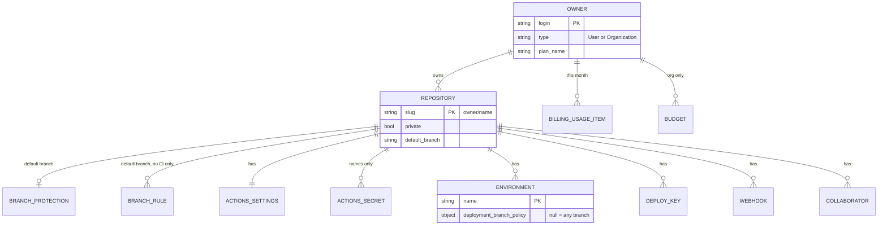

# Backend Schema: repo-create

> [!NOTE]
> No database and no server. The data model is what the audit **reads**: GitHub API objects, files in the audited repository's tree, the local clone, two local files, and plan tables in code. Nothing is stored between runs except the hook's empty marker files. Source of truth for every field: [`scripts/audit.ts`](../skills/repo-create/scripts/audit.ts), [`scripts/lib/owner.ts`](../skills/repo-create/scripts/lib/owner.ts), [`scripts/lib/plans.ts`](../skills/repo-create/scripts/lib/plans.ts) and [`hooks/trigger.sh`](../skills/repo-create/hooks/trigger.sh). Check ids: [`SKILL.md`](../skills/repo-create/SKILL.md).

## Entities the audit reads from GitHub

All through `gh api` GETs, except the `--owner` repo list (`gh repo list`, also a read). The identifier of a repository is its slug `owner/name`, from `--repo` or the `origin` URL; the default branch comes from the repository object.

| Entity | Endpoint (under `repos/<slug>/` unless absolute) | Fields read | Read by |
|---|---|---|---|
| Repository | `repos/<slug>` | `private`, `owner.login`, `owner.type`, `default_branch`, `name`, `allow_squash_merge`, `allow_merge_commit`, `allow_rebase_merge`, `delete_branch_on_merge`, `security_and_analysis.secret_scanning(_push_protection).status` | most checks |
| Owner (org) | `orgs/<owner>` | `plan.name`, `plan.seats`, `plan.filled_seats`, `two_factor_requirement_enabled`, `members_can_create_public_repositories`, `members_can_create_private_repositories`, `default_repository_permission` | `plan-detected`, `org-baseline`, `--owner` |
| Owner (user) | `user` (the authenticated account) | `login`, `plan.name`, `two_factor_authentication` | `plan-detected`, `account-2fa`, `--owner` |
| Owner type | `users/<login>` | `type` | `--owner` |
| Branch protection | `branches/<b>/protection` | `allow_force_pushes.enabled`, `allow_deletions.enabled`, `required_pull_request_reviews`, `enforce_admins.enabled`; the refusal kind (blocked, 404 "Branch not protected", other) | plan inference, `branch-baseline` |
| Branch rules | `rules/branches/<b>` (fetched only without a PR workflow) | `[].type`: `deletion`, `non_fast_forward`, `pull_request` | `branch-baseline` |
| Actions settings | `actions/permissions`, `.../selected-actions`, `.../workflow`, `.../artifact-and-log-retention`, `.../fork-pr-contributor-approval` (public), `.../fork-pr-workflows-private-repos` (private) | `enabled`, `allowed_actions`, `sha_pinning_required`; `verified_allowed`, `patterns_allowed`; `default_workflow_permissions`, `can_approve_pull_request_reviews`; `days`; `approval_policy`; `run_workflows_from_fork_pull_requests`, `send_write_tokens_to_workflows`, `send_secrets_and_variables` | `actions-policy`, `actions-token`, `log-retention`, `fork-pr-policy` |
| Dependabot | `vulnerability-alerts` (204 on, 404 off), `automated-security-fixes` | status code; `enabled`, `paused` | `dependabot-alerts`, `dependabot-security-updates` |
| Private vulnerability reporting | `private-vulnerability-reporting` (public only) | `enabled` | `private-vuln-reporting` |
| Actions secret | `actions/secrets?per_page=100` | `secrets[].name` only | `plan-environments`, `deploy-credential-scope` |
| Environment | `environments?per_page=100` | `total_count`, `environments[].name`, `environments[].deployment_branch_policy` | `deploy-credential-scope` |
| Deploy key | `keys?per_page=100` | `id`, `title`, `read_only` | `deploy-keys` |
| Webhook | `hooks?per_page=100` | `id`, `config.url` (host printed only), `config.insecure_ssl`, `config.secret` (presence only) | `webhooks` |
| Collaborator | `collaborators?affiliation=outside` (org) or `direct` (user), and `affiliation=all` when an environment is open | `login`, `permissions.admin`, `.maintain`, `.push` | `collaborators`, `deploy-credential-scope` |
| Billing usage item | `orgs/<o>` or `users/<u>` + `/settings/billing/usage?year=&month=` (private repos only) | `usageItems[].sku` (`Actions Linux`; Windows/macOS named, not counted), `quantity`, `netAmount`, `repositoryName` | `plan-minutes`, `--owner` |
| Budget | `orgs/<o>/settings/billing/budgets` | `budgets[].budget_scope`, `prevent_further_usage`, `budget_product_sku(s)`, `budget_amount` | `plan-minutes`, `--owner` |
| Repo list | `gh repo list <login> --limit 1000 --json …` | `name`, `visibility`, `isArchived`, `defaultBranchRef.name` | `--owner` |

> [!IMPORTANT]
> **Fail-closed reads.** A full page of 100 deploy keys or webhooks is unknown (the API returns a plain array with no total). Environments are checked against `total_count`. The secrets and collaborators lists are read 100 per page with no truncation check. Any error other than a plan refusal or a documented 404 is unknown, hence FAIL.

> [!NOTE]
> **Open follow-up (security-scan candidate C2, LOW, not confirmed):** an environment counts as open only when `deployment_branch_policy` is null, so one with a custom branch policy is never counted as open by the second-writer check, whatever its patterns allow.

## Data read from the repository and the local clone

| Data | Where it lives | Shape | Read by |
|---|---|---|---|
| Workflow files | `.github/workflows/*.yml\|yaml` at `<ref>`, via `git show` | YAML: `on` (a `pull_request` key makes it the CI workflow), `name`, `jobs.*.uses`, `jobs.*.steps[].uses` | `plan-protection`, `plan-environments`, `branch-baseline`, `actions-policy` |
| Security policy | `SECURITY.md` at the root, `.github/` or `docs/`, at `<ref>` | presence | `security-policy` |
| Commit author emails | `git log -n 200 --format=%ae <ref>` | addresses; only domains printed | `commit-email-noreply` |
| Pre-commit hook | the local clone's `core.hooksPath` or `<git-common-dir>/hooks/pre-commit` (not `<ref>`) | shell text, comment lines ignored | `gitleaks-precommit` |
| Origin URL | `git remote get-url origin` | a github.com URL | slug |

## Local files

| File | Where it lives | Shape | Identifier |
|---|---|---|---|
| Private prefixes | `REPO_CREATE_PREFIXES_FILE`, else `~/.config/ci-flow/private-prefixes`; outside any repo | one prefix per line; a trailing `-` or `_` dropped; no file = nothing matches | file path |
| Hook marker | `${TMPDIR:-$HOME/.cache}/repo-create-trigger/<session>/<crc>-<len>` | empty file; directory created with `umask 077` | session id reduced to `[A-Za-z0-9_-]` (empty = `nosession`) + `cksum` of the repository root |

## Plan tables in code

[`scripts/lib/plans.ts`](../skills/repo-create/scripts/lib/plans.ts) holds, per plan (`free`, `pro`, `team`, `enterprise`) and visibility: protection, environments, environment reviewers, secret scanning, CodeQL, private vulnerability reporting (`capsFor`), included Linux minutes (`QUOTA`) and Packages storage (`PACKAGES_GB`). The human-readable table is in [`SKILL.md`](../skills/repo-create/SKILL.md); neither is copied here.

## This repository's own `.github/` config

| File | Shape | Read by |
|---|---|---|
| [`.github/required-checks.json`](../.github/required-checks.json) | JSON array of check names | `scripts/protect-main.sh`, `tests/ci-workflow.test.ts` |
| [`.github/ci-flow.json`](../.github/ci-flow.json) | `{"addons": []}` | ci-flow's audit (design spec §8), not this one |
| [`.github/dependabot.yml`](../.github/dependabot.yml) | Dependabot v2, `github-actions` grouped | GitHub, and ci-flow's audit (design spec §8) |

The repo-create audit reads none of these three files from the repositories it audits.

## Status

- DONE: every entity above is read by shipped code.
- OPEN: any stored proposal or apply record (plan 2).
