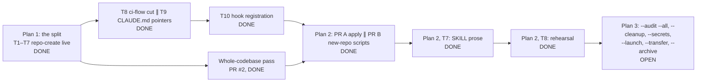

# Implementation Plan: repo-create

> [!NOTE]
> Order of work: design spec §10 ([`docs/superpowers/specs/2026-11-09-repo-create-design.md`](superpowers/specs/2026-11-09-repo-create-design.md)). Plan 1's tasks, gates and measured figures: [`docs/superpowers/plans/2026-11-09-repo-create-split.md`](superpowers/plans/2026-11-09-repo-create-split.md). Plan 2's tasks, owner decisions and gates: [`docs/superpowers/plans/2026-11-10-repo-create-apply.md`](superpowers/plans/2026-11-10-repo-create-apply.md). Plan 3 is not written yet; everything about it below comes from the design spec and is OPEN.

## Phases

The arrows into plan 2 are the order the design spec gives (§10 steps 3 and 4 after steps 1, 2 and 5); plan 2's gates are in its plan file.

| # | Phase | Status | Gate | Evidence |
|---|---|---|---|---|
| 1 | Plan 1, T1–T6: skeleton, `lib/`, `--owner`, the 24 checks, hook, POLICY/SKILL/README, own CI and protect script | DONE | `bun test tests/` green; every id has a mutation | 159 pass, 0 fail at a9b9244 |
| 1 | Plan 1, T7: create the GitHub repo (the skill's first real use) | DONE | suite green locally and in CI; the audit on itself reports 0 FAIL | this repository exists; live audit 22 pass / 0 fail / 2 n.a. (PR #2) |
| 1 | Plan 1, T8: ci-flow PR removing the moved checks, sections and POLICY part | DONE | lands together with T9, only after T7 | ci-flow PR #24 merged, cd09c88; ci-flow's audit now prints "moved: use … repo-create …" for `--owner` and `--config-only` |
| 1 | Plan 1, T9: CLAUDE.md pointer lines | DONE | lands together with T8 | claude-config PR #6 merged, ae1cd2a |
| 1 | Plan 1, T9: AGENTS.md mirrors | DONE (reported: direct owner-approved edits, backups outside the repo) | owner step (plan OPEN-3) | not checkable from this repository |
| 1 | Plan 1, T10: register repo-create's trigger beside ci-flow's in the owner's Claude Code settings | DONE | owner-approved claude-config PR; a fake `gh repo create` must fire | claude-config PR #7 merged, e6b8e07 (on claude-config `main`, read 2026-11-11) |
| — | Whole-codebase pass (CLAUDE.md §3f) | DONE | `/verify` green | PR #2 merged, a9b9244 |
| 2 | Plan 2, PR A (T0–T3): fixture, `audit.ts --json`, `apply.ts` with read-back by re-audit, proposal table | DONE | `bun test tests/` green; CI green; owner merges | PR #4 merged, 0ae45c4 |
| 2 | Plan 2, PR B (T4–T6): `scan.ts`, `starter.ts`, `local-setup.ts` | DONE | same | PR #5 merged, 782c043 |
| 2 | `protect-main.sh` first apply on an unprotected branch | DONE | same | PR #6 merged, 9c8465c |
| 2 | Hook misses: attached flags, field-first, `gh secret set`, deploy-key add, unarchive, quoted values | DONE | same | PR #7 merged, 55193f9 |
| 2 | Plan 2, T7 (PR C): SKILL.md journeys, POLICY "Run first", README, app-flow, this table | DONE | `grep -c AskUserQuestion SKILL.md` ≥ 3; render-docs `--check` exit 0; no new line shared with ci-flow's POLICY | PR #9 merged, c39cabb |
| 2 | Plan 2, T8: rehearsal on a throwaway private repo, then delete it | DONE | the owner in the session; the create, the approval and the delete each confirmed | 2026-11-12, a private repo on the Free personal account, from an empty folder with one `package.json`. Create read back PRIVATE; starter + local setup; first push verified by sha; a fake-secret commit blocked. Proposal 24 rows; owner approved `merge-hygiene`, `actions-policy`, `log-retention`; read-back all pass, matched by direct `gh api` GETs; no stale read-after-write seen. Audit 12 pass / 4 fail → 16 pass / 0 fail, 8 n.a. Repo deleted, GET 404. Findings fixed: the gitleaks detector misread the global hook (PR #10, aa993bc); the global hook skipped renames, so a rename adding a secret passed (claude-config #9, 3b38015). Open: `local-setup.ts` prints Synology Drive exclusions for a path outside Synology Drive |
| 3 | Plan 3: modes `--audit --all`, `--cleanup`, `--secrets`, `--launch`, `--transfer`, `--archive` | OPEN | TBD: plan 3 not written | design spec §3 |

## Dependencies

- Plan 1 order: T1 → T2 → T3 → T4 → T5 → T6 → T7 → (T8 ∥ T9, merged together, so no check is ever missing between the two skills) → T10.
- T10 needs the owner to commit their local settings first, then a claude-config PR the owner merges.
- Plan 2 order: T0 → T1 → T2 → T3 (PR A) → T4 ∥ T5 ∥ T6 (PR B) → T7 (PR C) → T8 rehearsal.
- Plan 2 builds on the audit (the "current" column of the proposal is the audit's row) and on the design spec's one-protection-writer rule.

## Follow-ups left open by the whole-codebase pass

| Item | Source | Status |
|---|---|---|
| claude-security scan (pass step 3) | PR #2: "not run yet", waiting on the owner's cost acknowledgment | OPEN |
| Candidate C2 (LOW, not confirmed): an environment with a custom branch policy is never counted as open by `deploy-credential-scope`'s second-writer check | security-scan triage; not yet written up elsewhere in the repository | OPEN |
| Deferred hook misses: attached flags, `--method=`, graphql mutation, `gh secret set`, deploy-key add, unarchive, heredoc bodies, partial owner wildcard | PR #2 | DONE for attached flags, `--method=`, `gh secret set`, deploy-key add, unarchive (PR #7, 55193f9); graphql stays ci-flow's; heredoc bodies and partial owner wildcard not named in PR #7, OPEN |
| `trigger.sh` method-parsing rewrite | PR #2 (/thermos, deferred) | OPEN |
| Not checked: whether Windows/macOS `quantity` is raw minutes; GitHub's protection answer to a non-admin token on a Free private repo; budget field names beyond one live budget | PR #2 | OPEN |

## Owner decisions

| Decision | Status | Source |
|---|---|---|
| The policy source is `POLICY.md`; CLAUDE.md points to it | DECIDED | design spec §8 |
| Two audit scripts, nothing shared at runtime | DECIDED | design spec §12 |
| Code scan = stack detection + an offered claude-security scan | DECIDED | design spec §12 |
| GitHub only; own public MIT repo, symlinked into the skills folder | DECIDED | design spec §12 |
| Modes in scope (plan 3 list, local clone setup, starter files, copyright level) | DECIDED | design spec §12 |
| Hook registration through one claude-config PR the owner merges | DECIDED; DONE (claude-config PR #7, e6b8e07) | design spec §12 |
| OPEN-1: ci-flow imports `plans.ts` by path or not | resolved as "no import": ci-flow's audit has no `lib/plans` import | plan 1; ci-flow `main` read 2026-11-09 |
| OPEN-2: which `gh api` writes stay with ci-flow's trigger | plan default in code: graphql, branch protection and rulesets are ci-flow's; every other write is repo-create's | plan 1; `trigger.sh` |
| OPEN-3: AGENTS.md mirrors outside any PR | resolved by direct owner-approved edits (reported) | plan 1 |
| OPEN-4: "no gap" depends on the owner pulling the skills checkout | OPEN: not checkable from this repository | plan 1 |
| Plan 2 OPEN-1, 2, 8, 9 and the controller's rulings on OPEN-3–7, 10 | DECIDED | plan 2, "Owner decisions (2026-11-10)" |
| Recreate repo-create with clean history after plan 2 lands | OPEN | owner, 2026-11-11; a one-way door (POLICY "One-way doors") |
