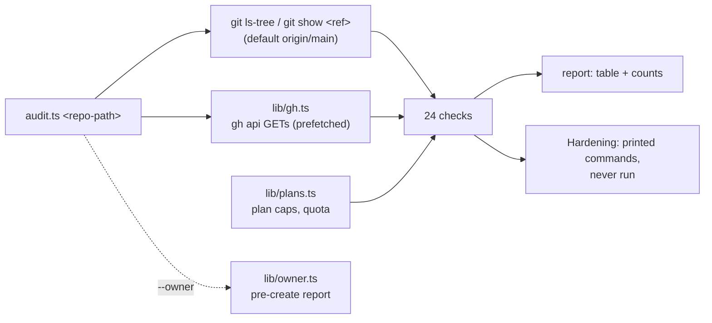
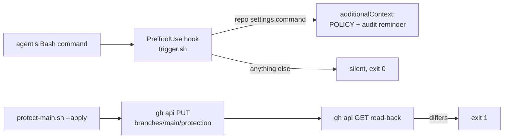

# Technical Requirements: repo-create

> [!NOTE]
> Rules: [`skills/repo-create/POLICY.md`](../skills/repo-create/POLICY.md). Check ids and the plan table: [`SKILL.md`](../skills/repo-create/SKILL.md). Code: [`scripts/audit.ts`](../skills/repo-create/scripts/audit.ts). Design: [`docs/superpowers/specs/2026-11-09-repo-create-design.md`](superpowers/specs/2026-11-09-repo-create-design.md) §9.

## Stack

| Part | Technology | File |
|---|---|---|
| Audit | `bun` + TypeScript (CI pins bun 1.4.4) | [`scripts/audit.ts`](../skills/repo-create/scripts/audit.ts) |
| GitHub and process plumbing | `gh api` via `spawnSync` / `Bun.spawn` | [`scripts/lib/gh.ts`](../skills/repo-create/scripts/lib/gh.ts) |
| Plan facts, minutes, random names | TypeScript tables | [`scripts/lib/plans.ts`](../skills/repo-create/scripts/lib/plans.ts) |
| `--owner` report | TypeScript | [`scripts/lib/owner.ts`](../skills/repo-create/scripts/lib/owner.ts) |
| Reminder hook | `bash` + `jq`, `git`, `cksum` | [`hooks/trigger.sh`](../skills/repo-create/hooks/trigger.sh) |
| This repo's own branch protection | `bash` + `gh` + `jq` | [`scripts/protect-main.sh`](../scripts/protect-main.sh) |
| Tests | `bun test` | [`tests/`](../tests/) |

## Architecture and data path

The audit reads the tree at a ref through `git show` (never the working tree), reads GitHub through `gh api` GETs, runs 24 checks and prints a table plus suggested fixes. The hook sits in Claude Code's PreToolUse path and only adds context. The protect script is the one writer here, and only for this repository's `main`.

## Interfaces

| Command | Exit codes (from the code) |
|---|---|
| `bun audit.ts <repo-path> [--ref <git-ref>] [--repo <owner/name>] [--strict]` | 0 always (a report); 1 with `--strict` and any FAIL (`blocked` does not count); 2 on usage, an unreadable ref or a bad `--repo` |
| `bun audit.ts --owner <login>` | 0 after the report; 2 when the login cannot be read |
| `bun audit.ts -h` / `--help` | 0 |
| `scripts/protect-main.sh [--dry-run\|--apply]` | 0 dry-run or a matching read-back; 1 on refusal or a read-back that differs; 2 on usage or a missing `gh`/`jq` |
| `hooks/trigger.sh` (stdin: PreToolUse JSON) | always 0; it never blocks |

No other flags exist. `--config-only` belonged to ci-flow and is not in this audit.

## Constraints

- **Read-only.** The audit writes nothing to GitHub; every fix is printed under "Hardening", never run. A test asserts every call is `api <path>` with no method or field.
- **Unknown = FAIL**, never PASS: an exception inside a check becomes `could not determine: …` and a FAIL row. A feature the plan refuses is `blocked`, not FAIL.
- **Fail-closed choices:**
  - A full page is unknown: `keys?per_page=100` or `hooks?per_page=100` returning 100 items is FAIL "may be truncated" (the API returns a plain array with no total). Environments are compared against their `total_count` instead.
  - `DEPLOYISH`: any secret name with a provider word (DEPLOY, VERCEL, AWS, SSH, …) counts as deploy-like, except names ending in `_REGION`, `_ORG_ID`, `_PROJECT_ID`, `_ANALYTICS_ID`, `_ACCOUNT_ID`. A new non-secret id has to be added to that list by hand.
  - The paid plan is inferred only from GitHub's "Branch not protected" 404; any other 404 leaves the plan unknown.
- **Secrets:** names only, never a value; webhook URLs print the host only; commit emails print domains only.
- **Sandbox:** `gh` fails TLS verification in a sandboxed shell; re-run the read-only audit outside it.
- **Hook ruling S5:** a missed reminder costs more than a false one, so the hook errs towards firing (quoted `gh` inside `bash -c` or `echo` fires). Known gaps are listed under Quality budgets.

## Performance and quality budgets

| Budget | Value | Status |
|---|---|---|
| Test suite | 159 pass, 0 fail across 4 files (`bun test tests/`) | DONE |
| Mutation coverage | every check id has at least one mutation that flips it to FAIL | DONE |
| CI job | one job, `timeout-minutes: 10`, gitleaks on the run's commits then the tests ([`ci.yml`](../.github/workflows/ci.yml)) | DONE |
| Audit speed | GETs prefetched in parallel; no measured wall-clock budget | TBD |
| Hook speed | fast path exits before `jq` when the payload has no `gh`; registration timeout planned at 5 s (plan T10) | TBD: not measured |
| Apply-step read-back (GET after each write) | plan 2 | OPEN |

> [!WARNING]
> **Deferred hook misses** (PR #2): attached flags, `--method=`, a graphql mutation, `gh secret set`, `gh repo deploy-key add`, unarchive, heredoc bodies, and a partial owner wildcard `x*/y` (listed with the hook misses, though it is the `actions-policy` check's wildcard pattern that does not catch it). Accepted false fires: `echo "gh repo create x"`, `gh api 'path' -X GET -f …`, `--method=GET -f`.

> [!NOTE]
> **Open follow-up (security-scan candidate C2, LOW, not confirmed):** `deploy-credential-scope` counts an environment as open only when `deployment_branch_policy` is null, so an environment with a custom branch policy is never counted as open by the second-writer check, whatever its patterns allow.

## Integrations

- **GitHub REST** through `gh api`: repository, branch protection and rules, Actions permissions, secrets (names), keys, hooks, environments, collaborators, org or user, billing usage and budgets. Fields: [backend schema](backend-schema.md).
- **ci-flow:** a repository with a pull-request workflow has its protection written by ci-flow's protect script, so `branch-baseline` is n.a. there (one protection writer per repo, design spec §8). ci-flow imports nothing from this repo at runtime.
- **gitleaks:** `gitleaks-precommit` looks for it in the local clone's pre-commit hook; this repo's CI runs it on each run's commits.
- **Private prefixes file:** a local file outside any repo (see [backend schema](backend-schema.md)).
